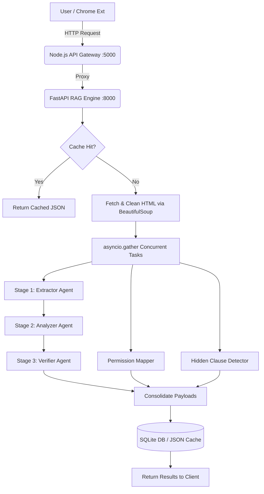

# PrivaShield AI - Project Overview & Interview Guide

This document breaks down the High Level Design (HLD), the selected technology stack with justifications, and the most anticipated interview questions (and answers) for the PrivaShield AI project.

## 1. High-Level Design (HLD)

The PrivaShield AI system is designed as a multi-tier, microservice-inspired architecture that processes legal text using a multi-agent workflow.

### Core Architecture Components
1. **Client Layer**:
   - **Web Dashboard**: Built with React & Vite.
   - **Chrome Extension (Manifest V3)**: Captures client-side hydrated DOM from Single Page Applications (SPAs).
2. **API Gateway Layer (Node.js/Express)**: 
   - Acts as a reverse proxy to handle CORS, routing frontend and extension traffic securely to the backend engine.
3. **RAG Engine Layer (Python/FastAPI)**:
   - Contains the core logic and handles asynchronous AI tasks.
   - **Parallel Processing**: Uses `asyncio.gather()` to concurrently run the Agentic Pipeline, OS Permission Mapper, and Hidden Clause Detector.
   - **3-Stage Agentic Pipeline**: 
     - *Extractor*: Mines facts and verbatim quotes.
     - *Risk Analyzer*: Applies a mathematical rubric for trust scoring.
     - *Verifier*: Validates quotes against the source text to eliminate AI hallucination.
   - **Caching System**: LangChain SQLite Cache (for exact prompt matching) and File-based URL Hash Cache (to bypass processing for known URLs).
4. **Storage Layer**:
   - **SQLite via SQLAlchemy**: Stores user accounts, history, and cached policy metrics.

### Request Flow

---

## 2. Tech Stack & Justifications

### Backend & AI (Python)
- **FastAPI / Uvicorn**: 
  - *Reason*: Provides native async support (`asyncio`) out of the box, which is critical for non-blocking I/O when making external LLM API calls. Also provides robust data validation via Pydantic.
- **LangChain & Groq**: 
  - *Reason*: LangChain offers standardized orchestration for prompting, RAG document splitting, and caching. Groq is used for high-speed inference.
- **Sentence-Transformers (`all-MiniLM-L6-v2`)**: 
  - *Reason*: Used for generating dense vector embeddings locally without relying on expensive external embedding APIs, ensuring fast semantic searches in the Q&A feature.
- **BeautifulSoup4**: 
  - *Reason*: Crucial for HTML sanitization—stripping out `<script>` and `<style>` tags to minimize token usage and prevent prompt injection attacks.
- **SQLAlchemy & SQLite**: 
  - *Reason*: Lightweight and portable ORM solution that easily scales to PostgreSQL in the future if required.

### API Gateway (Node.js)
- **Express & `http-proxy-middleware`**: 
  - *Reason*: Solves the Same-Origin Policy (CORS) restriction between the Vite frontend (`:5173`) and FastAPI backend (`:8000`). It securely routes traffic and modifies headers for the Chrome Extension.

### Frontend
- **React 19 & Vite**: 
  - *Reason*: Vite offers Hot Module Replacement (HMR) for extremely fast development. React handles complex UI states (animations, dashboard charts) efficiently.
- **Manifest V3 (Chrome Extension)**:
  - *Reason*: Modern SPAs (React/Vue) don't load text in a static GET request. The extension waits for the DOM to hydrate in the browser and sends the actual rendered text to the backend.

---

## 3. Most Asked Interview Questions & Answers

### Q1: Why did you implement a 3-stage pipeline (Extractor ➔ Analyzer ➔ Verifier) instead of doing it all in one LLM prompt?
**Answer**: LLMs struggle with complex, multi-step reasoning in a single pass. If asked to extract data and analyze it simultaneously, they often hallucinate or conflate information. By separating the pipeline, we achieve **Single Responsibility**: 
1. The Extractor only finds facts and exact quotes. 
2. The Analyzer only applies math based on the facts. 
3. The Verifier cross-checks that the quotes actually exist verbatim in the source text. This drastically reduces hallucinations and makes the system deterministic.

### Q2: How did you solve the issue of scraping Single Page Applications (SPAs) like React or Angular websites?
**Answer**: Traditional static scraping (like Python's `httpx` or `requests`) fails on SPAs because the server just returns an empty `

`. To solve this, I built a **Manifest V3 Chrome Extension**. The extension uses a content script that runs *after* the browser executes JavaScript and the DOM is fully hydrated. It captures the rendered `document.documentElement.outerHTML` and sends it directly to our backend.

### Q3: How are you managing concurrency to keep response times low? Why not use multi-threading?
**Answer**: I used Python's `asyncio.gather()` for cooperative multitasking. Multi-threading in Python is restricted by the Global Interpreter Lock (GIL) and introduces heavy OS thread overhead. Because our bottleneck is I/O bound (waiting for HTTP requests and LLM API responses), `asyncio` allows the event loop to switch to other tasks (like Permission Mapping or Hidden Clause scanning) while waiting, heavily reducing overall latency.

### Q4: How does your system prevent hallucinated answers in the RAG Chatbot?
**Answer**: I implemented a strict semantic boundary control and similarity guardrails. When a user asks a question, we use `SentenceTransformers` to find the top 5 overlapping text chunks. However, if the maximum cosine similarity score falls below our threshold (0.55), the system triggers a `document_silent_on_topic` flag. The chatbot will refuse to answer rather than fabricating a response.

### Q5: What happens if your vector embedding model (`all-MiniLM-L6-v2`) fails to load due to low system memory or hardware constraints?
**Answer**: The system has a built-in CPU-resilient fallback mechanism. If the neural network fails to initialize, it automatically downgrades to an in-memory TF-IDF (Term Frequency-Inverse Document Frequency) algorithm. It filters out stopwords and uses token-overlap keyword density to find relevant chunks, ensuring the Q&A feature never goes completely offline.

### Q6: How do you handle CORS and network isolation between the different tech stacks?
**Answer**: The frontend (Vite) runs on port 5173 and the Python backend on 8000. Calling Python directly from the browser causes CORS blocks. I introduced a Node.js Express Gateway running on port 5000 serving as a reverse proxy. The frontend sends requests to port 5000, which transparently proxies the payload to the Python engine while injecting the necessary CORS headers.

### Q7: Can you explain your caching strategy to prevent excessive API costs and rate limits?
**Answer**: I implemented a two-tier caching system:
1. **File-Based Result Cache**: Before any processing, the backend hashes the target URL using MD5. If an analysis JSON already exists for that hash, it returns it instantly (1-2ms), bypassing all AI and parsing logic.
2. **LangChain SQLite Cache**: For the LLM layer, I attached a `SQLiteCache` to the LangChain invocations. If the exact prompt was asked before (e.g., during testing or similar documents), it intercepts the network request and returns the previous response from the local DB, saving API credits.
